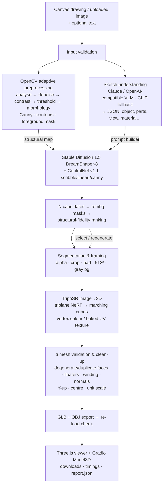

# ✏️ → 🧊 Sketch2Shape AI

**From a rough 2D sketch to a textured, exportable 3D asset** — TechZephyr 4.0 (IIT Bhubaneswar), 24-hour hackathon.

Draw on the canvas (or upload a photo/scan of a sketch), optionally describe the object, and Sketch2Shape returns a
real 3D mesh (`.glb` + `.obj`) that you can rotate, zoom and inspect in the browser — built from a pipeline of
**OpenCV → vision-language understanding → Stable Diffusion + ControlNet → rembg → TripoSR → trimesh**.

| | |
|---|---|
| **Inputs** | in-app canvas (brush · eraser · size · undo · clear · download) **or** PNG/JPG/JPEG upload; optional text + category/material/colour/style fields |
| **Output** | `model.glb` (geometry + colours/texture in one file), `model.obj` (+ `.mtl`/`.png`), a standalone Three.js `viewer.html`, `report.json` with every intermediate and timing |
| **Runs on** | one NVIDIA GPU ≥ 8 GB (default config); free Colab T4 notebook included; CPU works but slowly |
| **Licences** | our code MIT; every model is open (MIT / Apache-2.0 / OpenRAIL) — see [Attribution](#17-model-dataset-and-third-party-attribution) |

---

## Contents
1. [Introduction](#1-introduction) · 2. [Problem](#2-problem-statement) · 3. [Architecture](#3-system-architecture) ·
4. [Pipeline](#4-complete-pipeline-explanation) · 5. [Computer vision](#5-computer-vision-techniques) ·
6. [Generative AI](#6-generative-ai-models) · 7. [Image-to-3D](#7-image-to-3d-model-selection) ·
8. [Installation](#8-installation) · 9. [Hardware](#9-hardware-requirements) · 10. [Env vars & APIs](#10-api-requirements-and-environment-variables) ·
11. [Run](#11-commands-to-run) · 12. [I/O formats](#12-expected-input-and-output-formats) · 13. [Samples](#13-sample-inputs-and-outputs) ·
14. [Timing](#14-measured-generation-time) · 15. [Limitations](#15-known-limitations) · 16. [Troubleshooting](#16-troubleshooting) ·
17. [Attribution](#17-model-dataset-and-third-party-attribution) · 18. [Licences](#18-licences) · [Rubric map](#how-this-submission-maps-to-the-judging-rubric) · [Project layout](#project-layout)

---

## 1. Introduction
A sketch is usually the first form an idea takes, but turning it into a 3D asset needs modelling, UV and texturing
skills. Sketch2Shape lets anyone go from strokes to a usable mesh in one click while **keeping the sketch in charge**:
the drawing controls the structure, the text only controls semantics and appearance.

Design principles we held to:
* **Structure from pixels, semantics from language.** The OpenCV structural map drives ControlNet; the VLM never
  changes geometry and the user's words override its guesses.
* **Every intermediate is visible.** Original, cleaned grayscale, binary, Canny, contours, mask, ControlNet map,
  all candidates with fidelity scores, background-removed image, reconstruction input, raw mesh, final mesh.
* **Honest outputs.** Failures raise clear errors — the app never shows a placeholder model. Mesh reports state
  exactly what trimesh measured (watertightness is reported, never assumed).
* **Swappable components.** The orchestrator receives the generator and 3D backend as objects; TripoSR and
  InstantMesh are interchangeable via one env var.

## 2. Problem statement
A single-view sketch leaves depth, volume, hidden surfaces and materials unspecified, and strokes may be rough,
broken or noisy. Pure image processing finds edges but cannot invent hidden geometry; pure generation looks good
but drifts from the drawing. The task: an application that accepts a drawn or uploaded sketch (+ optional prompt)
and produces a recognisable, textured, exportable 3D model that preserves the sketch's primary structure.

## 3. System architecture



Process-level view: a single Python process (Gradio app, port 7860) holds the models after first load. GPU memory
is managed sequentially — on GPUs < 14 GB the diffusion pipeline uses model-CPU-offload and TripoSR is parked in
RAM while diffusion runs (and vice-versa). InstantMesh, when selected, runs in a separate process/venv because its
pinned dependencies conflict with ours (see §7).

## 4. Complete pipeline explanation

| # | Stage | Module | Input → Output | Saved as |
|---|---|---|---|---|
| 1 | Input & validation | `frontend/interface.py`, `utils/file_handler.py` | canvas RGBA / file → validated image (type, ≤ 10 MB, ≥ 64 px, not blank) | `00_original.png` |
| 2 | CV conditioning | `computer_vision/preprocessing.py`, `edge_detection.py` | image → normalised 512² crop, cleaned gray, binary, Canny, contours, mask, ControlNet map | `01`–`07_*.png` |
| 3 | Sketch understanding | `generative_ai/sketch_understanding.py` | clean sketch + text → `SketchDescription` JSON | `report.json` |
| 3b | Prompt building | `generative_ai/prompt_builder.py` | description → positive/negative prompt (77-token aware) | `report.json` |
| 4 | Sketch-guided generation | `generative_ai/image_generation.py` | control map + prompts → N images | `08_candidate_*.png` |
| 4b | Ranking | `computer_vision/edge_detection.py` | candidates + sketch → fidelity scores, auto-pick best | `09_overlay_*.png` |
| 5 | Segmentation & framing | `computer_vision/image_preparation.py` | image → alpha mask, RGBA, centred 512² recon input | `10`–`13_*.png` |
| 6 | Image → 3D | `reconstruction/image_to_3d.py` | recon input → mesh (+ colours/texture) | `20_raw_reconstruction.glb` |
| 7 | Mesh processing | `reconstruction/mesh_processing.py` | raw mesh → validated, cleaned, Taubin-smoothed, colour-corrected, oriented mesh; GLB (dielectric material + normals + linear vertex colours) / OBJ; re-load check | `export/model.glb`, `export/model_obj/` |
| 8 | Viewer & export | `frontend/viewer.py` | GLB → interactive Three.js page | `export/viewer.html` |

`pipeline/orchestrator.py` runs these as three resumable steps — `analyze()` (2–3), `generate()` (4),
`reconstruct()` (5–7) — so the UI can **regenerate images** or **rebuild 3D from another candidate** without
repeating earlier work. Each job lives in `outputs/jobs/<job_id>/` with `report.json` (inputs, operations, prompts,
candidate metrics, mesh reports, per-stage timings, warnings).

## 5. Computer-vision techniques
The preprocessor **inspects the input first** and only applies what that input needs; the operations actually
applied are listed in the UI and the report.

| Input type (auto-detected) | How it is detected | Extra operations applied |
|---|---|---|
| `clean_sketch` (canvas, scan) | bright uniform border, little speckle | none beyond Otsu + light morphology |
| `paper_photo` (phone photo) | low-frequency background std > 10 | illumination flattening (divide by median-estimated paper), median filter, CLAHE, adaptive threshold, speck filter |
| `noisy_sketch` | many 1–4 px components / noisy border | median filter, morphological opening, speck filter |
| `dark_background` (chalkboard, white-on-black) | border median < 110 | inversion |
| `photo` (colour image of an object) | Hasler–Süsstrunk colourfulness > 35 and dense content | bilateral filter, CLAHE, structure from Canny edges |

Always-on steps: transparency flattened onto white (canvas output is RGBA), **crop to content → pad to square →
resize to 512 px** (aspect ratio preserved, so the object fills the frame), Canny with median-adaptive thresholds,
3×3 closing to join broken strokes, a **speck filter that keeps thin elongated stroke fragments** (component kept if
large *or* long), contour hierarchy extraction (outer vs inner contours), and foreground segmentation by
**progressive closing + border flood-fill hole filling** (kernel grows 2.5 % → 7 % of the image until the outline's
gaps are bridged; if the outline is still open, the convex hull is used and the user is warned). Multiple separate
objects are detected and reported.

ControlNet maps (white on black): **scribble** = dilated strokes (tolerant to wobbly lines, default),
**lineart** = anti-aliased original strokes, **canny** = edge map (best for photos).

**Structural-fidelity diagnostic.** ControlNet output is pixel-aligned with its condition, so each candidate is
compared with the sketch in the same frame: stroke recall (sketch strokes with a generated edge within ~6 px,
via distance transform), edge precision, and silhouette IoU (sketch mask vs rembg mask).
`score = 0.45·IoU + 0.40·recall + 0.15·precision` ranks candidates and triggers a "drifted from your sketch" warning
below 0.35. It is a structural check, **not** a semantic similarity measure.

## 6. Generative AI models
**Sketch understanding (VLM).** The clean sketch is sent with a strict JSON schema prompt (object, confidence,
components, geometry, proportions, connections, ambiguities, material, colour, style, view). The prompt tells the
model to describe only what is drawn, list ambiguities instead of inventing, and never estimate hidden dimensions.
Backends (auto-selected): **Claude** (`ANTHROPIC_API_KEY`), any **OpenAI-compatible** vision endpoint (OpenAI,
Gemini's OpenAI endpoint, Groq, or a **local Ollama** `qwen2.5vl` for fully offline VLM), then **CLIP ViT-B/32
zero-shot** over 70 categories (offline, CPU), then keyword parsing. Merge rules: user's explicit
category/material/colour/style **override** the VLM; a low-confidence CLIP guess is discarded rather than allowed
to steer generation; CV-measured cues (aspect ratio, solidity) fill empty geometry fields.

**Prompt builder.** Priority-ordered and trimmed to SD-1.5's 77-token window: identity (style colour material
object) → the user's own words → reconstruction-friendly framing ("single complete object, centered, entire object
visible, isolated on a plain white background, studio product photo") → material texture → view → visible
components. The negative prompt removes the failure modes that break single-view 3D: multiple objects, cropping,
clutter, floors/shadows, people, text, "pencil sketch/lineart/monochrome".

**Sketch-guided generation.** Hugging Face Diffusers `StableDiffusionControlNetPipeline` with
**DreamShaper-8** (an SD-1.5 fine-tune that renders clean product shots far better than base SD-1.5) +
**ControlNet v1.1 scribble** (lineart/canny selectable), fp16, DPM++ 2M Karras, 25 steps, CFG 7,
`controlnet_conditioning_scale` 0.9 and `control_guidance_end` 0.85 (structure locked for most of denoising, last
steps free to refine surfaces). Two candidates per run with consecutive seeds; batch falls back to one-by-one on OOM.
**Colour uploads** (photos, coloured drawings) use ControlNet **image-to-image** instead: generation starts from the
uploaded picture (strength 0.75, `S2S_IMG2IMG_STRENGTH`), so its real colours and shading carry into the render.
Text-only conditioning would repaint a yellow cartoon duck as a white duck. The picture's dominant colour is also
named automatically (e.g. "yellow") and added to the prompt unless the user typed a colour.
`S2S_GEN_FAMILY=sdxl` switches to SDXL + `xinsir/controlnet-scribble-sdxl-1.0` + fp16-fix VAE at 1024 px.
*Why not feed the raw sketch as an image prompt (IP-Adapter)?* It transfers the sketch's black-on-white style into
the render; the sketch's information is structural, which ControlNet already carries.

## 7. Image-to-3D model selection
We checked the actual repositories (code, inference entry points, dependency pins, licences) before choosing.

| | **TripoSR** ✅ primary | InstantMesh (optional backend) | Unique3D |
|---|---|---|---|
| Licence | MIT | Apache-2.0 (code) | see repo |
| Input → output | 1 image → triplane NeRF → marching cubes; per-vertex colour; optional UV bake | 1 image → Zero123++ 6 views → sparse-view LRM → textured mesh | multi-stage multi-view + normal fusion |
| VRAM (per README) | ~6 GB at default settings | substantially more (two large models) | heavy |
| Speed | seconds on a modern GPU (< 0.5 s on A100 per authors) | tens of seconds (75 diffusion steps) | minutes |
| Dependency fit | only `transformers` ViT + omegaconf/einops; coexists with modern diffusers | pins `diffusers==0.20.2`, `transformers==4.34.1`, `nvdiffrast` → conflicts | many custom CUDA deps |
| Install risk in 24 h | low (we also ship a fallback for its one compiled dep) | medium-high | high |

**Decision:** TripoSR is the primary model — fast, low-VRAM, MIT, real volumetric geometry with colour, and the
lowest integration risk. InstantMesh is integrated as an **optional higher-quality backend** that runs its official
`run.py` *in its own virtualenv as a subprocess*, because importing it would require downgrading diffusers and break
Stage 4. We never combine incompatible pipelines in one interpreter.

**How TripoSR is integrated** (`reconstruction/image_to_3d.py`): the repo is cloned at a pinned commit by
`scripts/setup.sh`; `TSR.from_pretrained("stabilityai/TripoSR", "config.yaml", "model.ckpt")` is loaded once and
cached; input is the 512² RGB composited on 50 % gray with the object filling 85 % (exactly TripoSR's own
preprocessing); `extract_mesh(scene_codes, has_vertex_color=True, resolution=256)`; on CUDA OOM it retries at
75 % marching-cubes resolution with smaller chunks; with `S2S_BAKE_TEXTURE=1` it UV-unwraps (xatlas) and bakes the
triplane colour into a PBR texture using TripoSR's own `bake_texture`, falling back to vertex colours if no OpenGL
context exists. The native frame is rotated to glTF Y-up with the same transform as TripoSR's viewer.

**`torchmcubes` fallback.** TripoSR imports `torchmcubes`, a C++/CUDA extension that often fails to compile
(Windows, some cloud images). `reconstruction/mc_shim.py` registers a drop-in module backed by PyMCubes or
scikit-image **only if** the real one is missing, with the same vertex-order convention (unit-tested against an
analytic sphere). Inverted winding, if any, is fixed in Stage 7.

**Appearance post-processing (Stage 7).** Raw single-view reconstructions look lumpy and muddy. Three fixes address this:
* **Taubin smoothing** (λ = 0.5, ν = 0.52, 8 iterations) removes marching-cubes "orange peel" without shrinking
  the object.
* **Laplacian vertex-colour smoothing plus Reinhard colour transfer in CIELAB** matches the mesh's colour mean and
  spread to the object pixels of the generated image. The model gets back the image's brightness and saturation;
  the scale is clamped to 0.7–1.6× so no contrast is invented.
* **A correct glTF material.** trimesh writes no material for vertex-coloured meshes, and glTF's default is fully
  metallic, which renders almost black without an environment map. The export adds a dielectric, double-sided
  material (metallic 0, roughness 0.75), smooth vertex normals, and converts vertex colours to the linear space the
  glTF spec requires. The OBJ keeps sRGB colours.

## 8. Installation
**Fastest path — Google Colab (free T4 GPU):** open `notebooks/Sketch2Shape_Colab.ipynb`, set runtime to GPU,
run all cells. It installs everything, runs tests, benchmarks all samples, and starts the app with a public link.

**Local (Linux / WSL / macOS):**
```bash
python -m venv .venv && source .venv/bin/activate      # Python 3.10–3.12
pip install torch torchvision --index-url https://download.pytorch.org/whl/cu121   # match your CUDA
bash scripts/setup.sh          # requirements, TripoSR @ pinned commit, torchmcubes (optional), env check, model download
python app.py                  # → http://localhost:7860
```
**Windows:** activate a venv, install CUDA PyTorch as above, then `scripts\setup_windows.bat`
(skips the torchmcubes build on purpose — the built-in fallback is used).

**Manual equivalent of `setup.sh`:**
```bash
pip install -r requirements.txt
git clone https://github.com/VAST-AI-Research/TripoSR third_party/TripoSR
git -C third_party/TripoSR checkout 107cefdc244c39106fa830359024f6a2f1c78871
pip install --no-build-isolation git+https://github.com/tatsy/torchmcubes.git   # optional
python scripts/download_models.py
cp .env.example .env
```

**Optional InstantMesh backend** (separate venv, needs ≥ 16 GB VRAM — check the InstantMesh README for current figures):
```bash
git clone https://github.com/TencentARC/InstantMesh third_party/InstantMesh
python -m venv third_party/InstantMesh/.venv
# install InstantMesh's own environment exactly as its README specifies (its torch/CUDA build + requirements.txt,
# which pins diffusers==0.20.2, transformers==4.34.1 and builds nvdiffrast)
third_party/InstantMesh/.venv/bin/pip install -r third_party/InstantMesh/requirements.txt
# then in .env:  S2S_RECON_BACKEND=instantmesh
```

## 9. Hardware requirements
| Configuration | GPU | Notes |
|---|---|---|
| Minimum | 8 GB VRAM (e.g. RTX 3060 Ti/4060) | `S2S_OFFLOAD=always S2S_NUM_CANDIDATES=1 S2S_MC_RES=192` |
| **Default / tested target** | 12–16 GB (Colab T4, RTX 3060 12 GB, 4070) | SD-1.5 + ControlNet fp16 ≈ 4–5 GB, TripoSR ≈ 6 GB; parked between stages |
| Comfortable | ≥ 16 GB (A10G, 4090, A100) | everything resident; `S2S_GEN_FAMILY=sdxl` optional |
| CPU only | — | works, but diffusion takes minutes per image |

Also: ~12 GB disk for weights + environment, 16 GB system RAM recommended. `python scripts/check_env.py` prints
GPU, VRAM, CUDA, torch, RAM and disk, and recommends a configuration. Figures above are planning estimates;
the **measured** peak VRAM of every run is written to the job log/report.

## 10. API requirements and environment variables
No API is required. Optional keys improve sketch understanding (§6). All settings live in `.env`
(template: `.env.example`; real env vars override it; `.env` is git-ignored).

| Variable | Default | Purpose |
|---|---|---|
| `S2S_VLM_BACKEND` | `auto` | `anthropic` / `openai` / `clip` / `none` |
| `ANTHROPIC_API_KEY`, `ANTHROPIC_MODEL` | – , `claude-haiku-5-5` | Claude vision for sketch understanding |
| `OPENAI_API_KEY`, `OPENAI_BASE_URL`, `OPENAI_MODEL` | – | any OpenAI-compatible VLM (incl. local Ollama) |
| `S2S_GEN_FAMILY` / `S2S_SD15_MODEL` | `sd15` / `Lykon/dreamshaper-8` | diffusion model |
| `S2S_CONTROL_TYPE` | `scribble` | `scribble` / `lineart` / `canny` |
| `S2S_NUM_CANDIDATES`, `S2S_STEPS`, `S2S_CFG`, `S2S_CN_SCALE`, `S2S_CN_END`, `S2S_GEN_RES` | 2, 25, 7.0, 0.9, 0.85, 512 | generation |
| `S2S_RECON_BACKEND` | `triposr` | `triposr` / `instantmesh` |
| `S2S_TRIPOSR_MODEL`, `S2S_MC_RES`, `S2S_BAKE_TEXTURE`, `S2S_TEX_RES` | HF id, 256, 0, 1024 | reconstruction |
| `S2S_OFFLOAD`, `S2S_LOW_VRAM_GB`, `S2S_DEVICE` | `auto`, 14, `auto` | memory strategy |
| `S2S_PORT`, `S2S_SHARE`, `S2S_PRELOAD` | 7860, 0, 0 | server |

## 11. Commands to run
```bash
python app.py                    # web app (add --share for a public link, --preload to load models first)
python scripts/run_cli.py samples/02_chair.png --prompt "walnut mid-century chair" --seed 7   # headless
python scripts/benchmark.py --warmup     # all test sketches → outputs/benchmark/results.{md,json}
python -m pytest -q tests                # 46 unit/integration tests (CPU, no weights needed)
python scripts/check_env.py              # hardware + dependency report
python scripts/make_samples.py           # regenerate the test sketches
python scripts/finalize_submission.py    # after benchmark: artefacts -> outputs/submission, results -> README, zip
```
The Gradio app also exposes an HTTP API automatically (see "Use via API" in the page footer), so the pipeline can
be scripted with `gradio_client`.

## 12. Expected input and output formats
**Input:** canvas drawing (512 × 512, RGBA) or PNG/JPG/JPEG upload (≤ 10 MB, 64–4096 px). One object per sketch
works best. Dark strokes on light paper, light strokes on dark boards, phone photos of paper, and colour photos
are all handled. Text is optional.

**Output (per job, `outputs/jobs/<id>/`):**
`export/model.glb` (glTF 2.0 binary; Y-up; centred; unit size; `COLOR_0` vertex colours or a PBR base-colour
texture), `export/model_obj/model.obj` + `.mtl` (+ `.png` when textured), `export/model_obj.zip`,
`export/viewer.html` (self-contained Three.js viewer), `20_raw_reconstruction.glb` (untouched model output),
all intermediate PNGs, and `report.json`.

## 13. Sample inputs and outputs
`samples/` contains six procedurally generated hand-drawn-style sketches that were **not** used to tune the
pipeline, covering every category the problem statement asks for:

| File | Category tested | Detected input type |
|---|---|---|
| `01_cup.png` | simple object | clean_sketch |
| `02_chair.png` | furniture | clean_sketch |
| `03_table_lamp.png` | multiple structural components | clean_sketch |
| `04_car_rough.png` | rough, **broken** outline | clean_sketch (open-outline handling) |
| `05_noisy_photo_vase.png` | phone photo of paper: shadow, grain, JPEG noise, blue ink | paper_photo |
| `06_house_chalkboard.png` | white chalk on dark board | dark_background |

The CV intermediates for all six are in `docs/cv_intermediates.png`.
**Generated images and GLBs:** produced by `python scripts/benchmark.py` into `outputs/benchmark/<sample>/`
(`input.png`, `control_map.png`, `generated.png`, `model.glb`). Copy that folder to `outputs/submission/` for the
submission artefact (the Colab notebook's last cell does this).

## 14. Measured generation time
All numbers below are **measured**, never estimated: per-stage `time.perf_counter()` timings from the job
reports and logs of real runs. `scripts/benchmark.py` reproduces them on any GPU.

**Hardware:** Google Colab, NVIDIA Tesla T4 (15 GB), 2 vCPU, 12.7 GB RAM, torch 2.11 + CUDA 13.0, Python 3.13.
**Config:** DreamShaper-8 + ControlNet scribble, fp16, 25 steps @ 512 px · rembg `isnet-general-use` · TripoSR,
marching cubes 256³ (PyMCubes fallback) · VLM: Gemma 3 4B via Ollama (local). Measured 31 Oct 2026.

**Warm runs in the web app** (models preloaded, 2 candidates per sketch):

| Stage | Chair (hand-drawn) | Apple (hand-drawn) |
|---|---|---|
| 1 CV preprocessing | < 0.5 s | < 0.5 s |
| 2 Sketch understanding (Gemma 3 4B, incl. reload) | 9 s | 11 s |
| 3 ControlNet diffusion, 2 × 25 steps (batched) | 10.1 s | 10.3 s |
| 4 Candidate ranking (rembg on 2 images + fidelity) | 8 s | 9 s |
| 5–6 Framing + TripoSR (triplane + marching cubes) | 4 s | 5 s |
| 7 Mesh validation, clean-up, GLB/OBJ export | 1 s | 3 s |
| **Total, click → GLB** | **33 s** | **39 s** |
| Result | 32,986 vertices / 65,976 faces, fidelity 0.90 | 69,039 vertices / 138,082 faces, fidelity 0.80 |

Peak PyTorch VRAM per job: **5.0 GB**. System RAM stayed below 6.2 / 12.7 GB.

**One-time costs:**
* Model loading at app start (`--preload`): 24.8 s for diffusion + 11.6 s for TripoSR ≈ **37 s**.
* First-ever request in a fresh runtime (CLI, nothing cached in memory): **180 s**. Of that, Gemma's first load from disk
  took 110 s, the diffusion pipeline load 26 s, TripoSR load 12 s, and the rembg session 3–5 s.

Full 6-sketch benchmark: run `python scripts/benchmark.py --warmup` (notebook cell 5) and paste
`outputs/benchmark/results.md` here.

<!-- BENCHMARK_RESULTS_START -->
<!-- BENCHMARK_RESULTS_END -->

## 15. Known limitations
* **Single-view ambiguity.** Hidden sides are *inferred* by TripoSR; backs of objects are plausible, not exact.
* **Thin structures.** Chair legs, lamp stems and bicycle spokes thinner than ~1/100 of the object can be thickened,
  merged or lost by the 256³ marching cubes; raise `S2S_MC_RES` to 320–384 if VRAM allows.
* **Colour vs texture.** Default output uses per-vertex colour (resolution tied to mesh density). UV texture baking
  is available (`S2S_BAKE_TEXTURE=1`) but needs an OpenGL context; on headless servers it falls back to vertex colours
  and says so in the report.
* **No metric scale.** Meshes are normalised to unit size.
* **Topology.** Not guaranteed watertight or manifold; not print- or animation-ready (outside mandatory scope). The
  report states watertightness exactly as measured.
* **Semantic drift.** Very abstract sketches can be rendered as a different object; the fidelity score and VLM-vs-user
  conflict warnings flag this, and adding the object name to the prompt fixes most cases.
* **Fidelity score** is structural (edges/silhouette), not semantic.
* **Validation status:** the unit tests (46) run on CPU without weights, using small test doubles for the GPU
  models. The full pipeline (Gemma → ControlNet → rembg → TripoSR → GLB) was run end-to-end on a Colab T4, both from
  the CLI and from the web app (§14). Gemma 3 4B sometimes misreads rough sketches; naming the object in the prompt fixes it.
* **Colab sessions** reset after idle time; the notebook is re-runnable and skips completed installs.

## 16. Troubleshooting
| Symptom | Fix |
|---|---|
| `CUDA out of memory` | `S2S_OFFLOAD=always`, `S2S_NUM_CANDIDATES=1`, `S2S_MC_RES=192`; restart to free fragmented memory |
| `TripoSR source not found` | `bash scripts/setup.sh` (clones into `third_party/TripoSR`) |
| torchmcubes fails to build | nothing to do — the shim is used automatically (`marching cubes: shim:PyMCubes` in the report) |
| `Could not load diffusion weights` / HF 401 | check internet; `huggingface-cli login`; pre-download with `scripts/download_models.py`; or point `S2S_*_MODEL` to local folders |
| rembg model download fails | segmentation falls back to OpenCV flood-fill + GrabCut automatically (works well on our white studio backgrounds) |
| Generated object differs from sketch | raise ControlNet strength (Advanced, 1.0–1.3), switch to `lineart`, name the object in the prompt, Regenerate |
| Object cropped / touches border | warning is shown; Regenerate; reduce sketch to one object |
| Mesh looks inside-out / dark | handled by winding/inversion repair; toggle "Unlit colours" in the viewer to inspect raw colours |
| Texture bake skipped | needs an OpenGL context (`moderngl`); use a desktop/GPU VM or keep vertex colours |
| Gradio canvas tools missing | ensure `gradio>=5.30,<6` (`pip show gradio`) |
| Port in use | `python app.py --port 7861` |

## 17. Model, dataset and third-party attribution
Pretrained models (no training or fine-tuning was performed; no datasets were used). Licences are listed as we
understand them — the model cards are authoritative:
* **TripoSR** — Tochilkin et al., *TripoSR: Fast 3D Object Reconstruction from a Single Image* (2024), Stability AI & Tripo AI — MIT.
* **Stable Diffusion v1.5** — Rombach et al., *High-Resolution Image Synthesis with Latent Diffusion Models*, CVPR 2022 — CreativeML OpenRAIL-M; **DreamShaper 8** fine-tune by Lykon — CreativeML OpenRAIL-M.
* **ControlNet v1.1** — Zhang, Rao & Agrawala, *Adding Conditional Control to Text-to-Image Diffusion Models*, ICCV 2023 — `lllyasviel/control_v11p_sd15_*`.
* Optional: **SDXL** (Stability AI, OpenRAIL++), **xinsir ControlNet SDXL** (Apache-2.0), **SDXL-VAE-FP16-Fix** (madebyollin, MIT).
* **InstantMesh** (optional backend) — Xu et al. 2024, TencentARC — Apache-2.0; uses **Zero123++** (Shi et al.) weights under their own licence.
* **CLIP** — Radford et al. 2021, OpenAI — MIT. **DINO ViT-B/16** config (TripoSR backbone) — Caron et al. 2021, Meta — Apache-2.0.
* **rembg** (Daniel Gatis, MIT) with **IS-Net / DIS** (Qin et al. 2022, Apache-2.0).
* Optional hosted VLMs: Anthropic Claude, or any OpenAI-compatible endpoint chosen by the user.
* Libraries: PyTorch, Hugging Face Diffusers / Transformers / Accelerate, OpenCV, NumPy, Pillow, scikit-image,
  PyMCubes, trimesh, xatlas, moderngl, Gradio, Three.js (MIT, via jsDelivr CDN).

## 18. Licences
Our source code: MIT (see `LICENSE`). Model weights are **not** redistributed; they are downloaded from their
official repositories and remain under their own licences (table in `models/README.md`). OpenRAIL-M models carry
use-based restrictions that apply to generated content. The Stable Diffusion safety checker is disabled because it
blacks out harmless product renders, which breaks the 3D stage; users remain responsible for prompts under the
OpenRAIL-M terms.

---

## How this submission maps to the judging rubric
| Criterion (points) | Where to look |
|---|---|
| Technical implementation (25) | adaptive CV (§5), VLM merge rules (§6), ControlNet + candidate ranking, TripoSR integration with OOM retry and marching-cubes fallback (§7), typed errors at every stage, 46 tests |
| 3D output quality (25) | DreamShaper-8 product renders, reconstruction-friendly prompts, fidelity-ranked candidates, floater removal and normal repair, optional UV texture bake |
| End-to-end validity & efficiency (20) | one click from canvas to GLB; models cached; sequential GPU memory; measured per-stage timings in UI and report |
| Reproducibility (15) | `setup.sh` / `setup_windows.bat` / Colab notebook, pinned TripoSR commit, bounded dependency versions, `check_env.py`, `.env.example` |
| Documentation (15) | this README, `docs/DEMO_SCRIPT.md`, `models/README.md`, per-job `report.json` |

## Project layout
```
Sketch2Shape/
├── app.py                         # entry point (Gradio)
├── config/settings.py             # every tunable, env-overridable
├── computer_vision/
│   ├── preprocessing.py           # Stage 2: adaptive OpenCV pipeline
│   ├── edge_detection.py          # Canny + structural-fidelity diagnostic
│   └── image_preparation.py       # Stage 5: rembg / GrabCut, alpha, framing
├── generative_ai/
│   ├── sketch_understanding.py    # Stage 3: Claude / OpenAI-compatible / CLIP / keywords
│   ├── prompt_builder.py          # token-aware prompt assembly
│   └── image_generation.py        # Stage 4: SD + ControlNet (Diffusers)
├── reconstruction/
│   ├── image_to_3d.py             # Stage 6: TripoSR (primary) + InstantMesh (subprocess)
│   ├── mc_shim.py                 # torchmcubes fallback
│   └── mesh_processing.py         # Stage 7: validation, clean-up, GLB/OBJ export
├── pipeline/{orchestrator,job_manager}.py
├── frontend/{interface,viewer}.py # Gradio UI + Three.js viewer
├── utils/{file_handler,logging_utils,gpu}.py
├── scripts/                       # setup, check_env, download_models, run_cli, benchmark, make_samples
├── notebooks/Sketch2Shape_Colab.ipynb
├── samples/                       # 6 unseen test sketches
├── tests/                         # pytest suite (46 tests)
├── docs/                          # demo script, CV intermediates figure
├── models/README.md · data/ · outputs/
```
